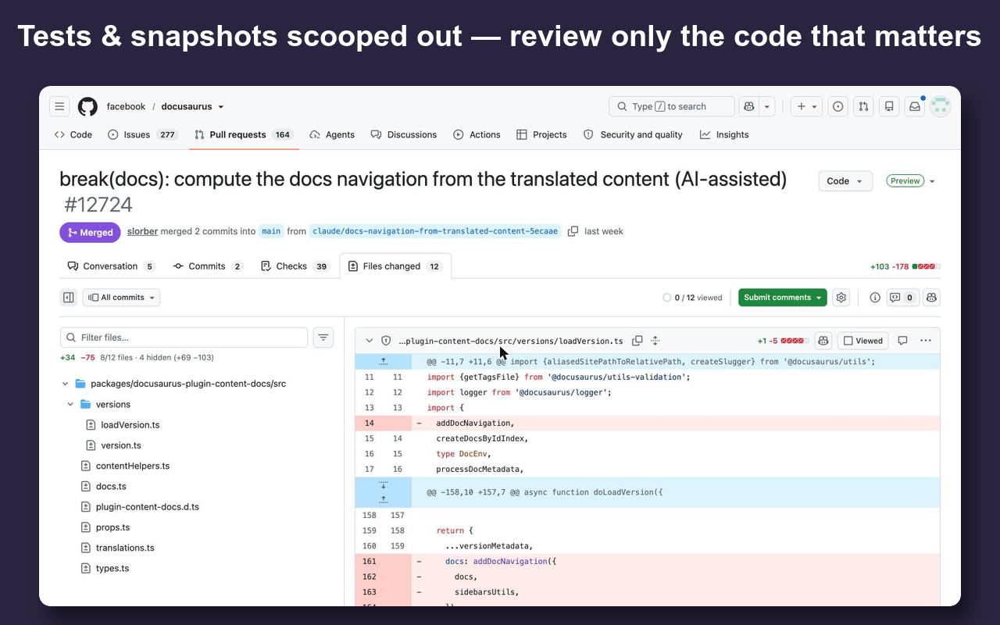
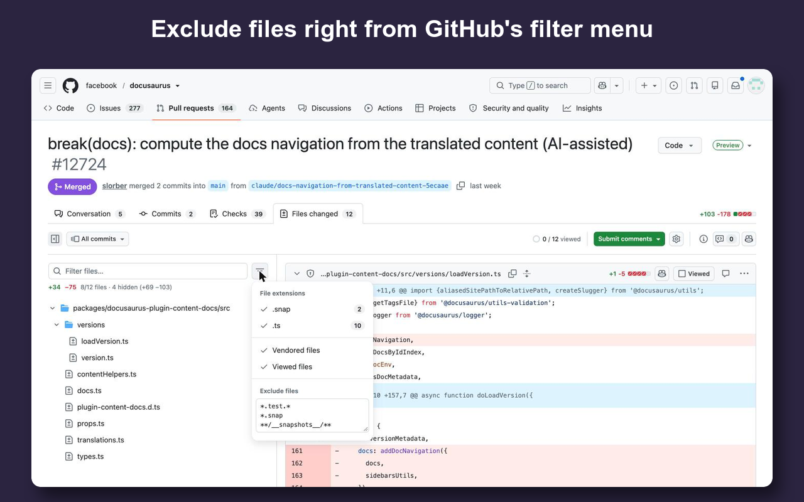

<p align="center">
  
</p>

<h1 align="center">Litterbox for GitHub PRs</h1>

<p align="center"><b>Scoop tests, snapshots and other noise out of pull request diffs — and see the real +/− line count.</b></p>



## What it does

On a pull request's **Files changed** tab, Litterbox adds an **Exclude files** box to GitHub's filter menu (the button next to "Filter files…").

- Matching files disappear from the file tree **and** the diff.
- A line under the search box shows the `+added −removed` count for what's left, plus how many files and lines were hidden.
- Your patterns are saved and follow you across PRs (and Chrome profiles, via sync).
- Line counts come from GitHub's own page data, so they're exact even for diffs that haven't loaded yet.



## Install

- **Chrome Web Store:** _coming soon_
- **From source:** clone this repo → `chrome://extensions` → enable **Developer mode** → **Load unpacked** → pick the folder.

## Patterns

Comma or newline separated. Default: `*.test.*, *.spec.*, *.snap, **/__snapshots__/**`

| Pattern               | Matches                                      |
| --------------------- | -------------------------------------------- |
| `*.test.tsx`          | file name, in any folder                     |
| `*.snap`              | Jest snapshots                               |
| `**/__snapshots__/**` | anything under a `__snapshots__` folder      |
| `db/snapshots/**`     | path glob (`*` = no `/`, `**` = any path)    |
| `migrations`          | no wildcard = substring anywhere in the path |

## Privacy

No data collection, no analytics, no third-party requests. See [PRIVACY.md](PRIVACY.md).

## Development

```sh
./scripts/package.sh   # → dist/litterbox-<version>.zip, ready for the Chrome Web Store
```

Releases: bump `version` in `manifest.json`, tag `vX.Y.Z` and push the tag. The GitHub Action attaches the zip to a GitHub release.

The extension relies on GitHub's current PR "changes" page markup. If GitHub ships a redesign and something breaks, please [open an issue](https://github.com/ai-meow/litterbox/issues).

## License

[MIT](LICENSE). Not affiliated with or endorsed by GitHub.
